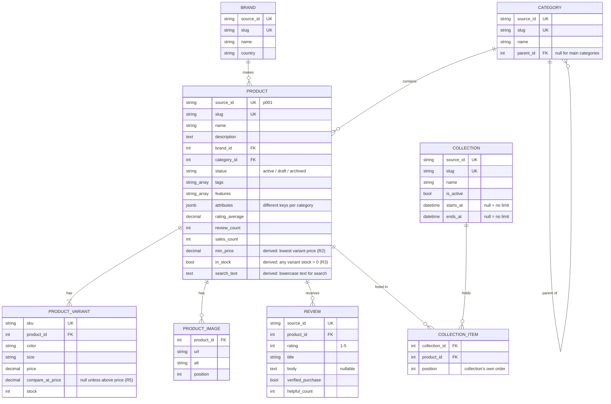

# Home & Living — Product Catalog

PostgreSQL + Django REST API + Next.js storefront for a home and living shop, seeded from `catalog.json`.

## 1. Setup

```bash
docker compose up --build
```

No `.env` needed. The API container migrates and seeds the database on start (idempotent: restarts never duplicate data).

| Service | URL |
| --- | --- |
| Frontend | http://localhost:3000 |
| API | http://localhost:8000/api/products |
| Health check | http://localhost:8000/api/health |

Ports busy? `API_PORT=8001 WEB_PORT=3001 docker compose up --build`. Fresh database: `docker compose down -v`.

**Tests:** `cd backend && pytest` (71 tests against a real seeded database).

**Without Docker:** copy `.env.example` to `.env`, then `pip install -r backend/requirements.txt`, `python manage.py migrate && python manage.py seed && python manage.py runserver` in `backend/`, and `npm install && npm run dev` in `frontend/`.

## 2. Tech stack

| | Choice | Why |
| --- | --- | --- |
| Database | PostgreSQL 17 | JSONB for varying attributes, arrays, partial indexes, `pg_trgm` for substring search |
| API | Django 6 + Django REST Framework | ORM, migrations and a management command for the seed; serializers validate input |
| Frontend | Next.js 16, React 19, TypeScript, Tailwind 4 | Server-rendered pages; search, filters, sort and page are kept in the URL, so reload, back button and a copied link all show the same results |
| Tests | pytest + pytest-django | Run against the real seeded database, no mocks |

## 3. Database schema



All tables also have `created_at` / `updated_at`. `source_id` is the id from the JSON; the seed upserts on it and the API returns it as `id`.

**Why this shape**
- **Attributes in one JSONB column:** there are 23 different keys across categories (`pileHeightMm` for rugs, `burnTimeHours` for candles). Separate columns would be mostly empty. `null` values are dropped at import.
- **Tags and features as arrays:** only ever read together with their product.
- **`min_price`, `in_stock`, `search_text` are computed by the seed:** rules R2/R3 become plain indexed columns, so no sub-query per product. Trade-off: they must be refreshed whenever variants change.
- **Constraints guard the data:** unique `(product, color, size)`, `price > 0`, `compare_at_price > price`, rating 1–5, `ends_at > starts_at`.

### Indexes

Product indexes are **partial** (`WHERE status = 'active'`), because every public query only shows active products (R1). Each sort index ends with `id` so paging is stable.

| Index | Why |
| --- | --- |
| GIN trigram on `product.search_text` | `q` search (`LIKE '%word%'`) uses the index instead of scanning every row |
| `product (min_price, id)` | Price sorting and the `minPrice` / `maxPrice` filters |
| `product (created_at DESC, id)` | Default sort `newest` |
| `product (rating_average DESC NULLS LAST, id)` | `sort=rating` with unrated last, `minRating` filter |
| `product (sales_count DESC, id)` | `sort=popular` |
| `review (product_id, created_at DESC)` | A product's reviews, newest first, paginated |
| Foreign keys (`brand_id`, `category_id`, `product_id`, …) | Brand/category filters; loading variants, images, collection products |
| Unique `slug`, `sku`, `source_id` | Detail pages by slug; seed upsert |

## 4. API

Base URL `http://localhost:8000/api`. Read-only (`GET`), JSON with camelCase keys, prices in EUR. All lists and counts only include visible products (R1).

### Endpoints

| Method | Path | Description |
| --- | --- | --- |
| `GET` | `/products` | Product list with search, filters, sorting, pagination |
| `GET` | `/products/:slug` | Product detail: brand, category path, attributes, features, images, variants |
| `GET` | `/products/:slug/reviews` | Reviews, newest first, paginated (`?sort=helpful` for most helpful) |
| `GET` | `/products/:slug/similar` | Up to 4 similar products |
| `GET` | `/categories` | Category tree with product counts (a main category includes its subs) |
| `GET` | `/brands` | Brands with product counts |
| `GET` | `/collections` | Visible collections (R4) |
| `GET` | `/collections/:slug` | One collection with its products, in its own order, paginated |
| `GET` | `/search/suggest?q=` | Autocomplete: products, categories, brands *(extra)* |
| `GET` | `/health` | API and database are up; used by Docker *(extra)* |

### `GET /products` parameters

All optional and combinable.

| Parameter | Example | Behaviour |
| --- | --- | --- |
| `q` | `q=oak dining` | Name, description, brand, category, material and tags. Case-insensitive, partial words, every word must match. Typos are corrected. |
| `category` | `category=lighting` | A main category includes its sub-categories |
| `brand` | `brand=oakline,north-house` | Any of the listed brands |
| `minPrice` / `maxPrice` | `minPrice=100&maxPrice=300` | Inclusive, on the lowest variant price (R2) |
| `inStock` | `inStock=true` | Only products with a variant in stock (R3) |
| `minRating` | `minRating=4` | 1–5; unrated products are left out |
| `sort` | `sort=price_asc` | `newest` (default), `price_asc`, `price_desc`, `rating` (unrated last), `popular` |
| `page` | `page=2` | ≥ 1, default 1. Past the last page → `200` with empty `items` |
| `limit` | `limit=12` | 1–50, default 12 |

Reviews and collection detail take `page` and `limit` too.

### Example responses

`GET /api/products?q=candle&category=decor&inStock=true&sort=price_asc&limit=1`

```json
{
  "items": [
    {
      "id": "p043",
      "slug": "taper-candles-set-of-6",
      "name": "Taper Candles (Set of 6)",
      "brand": { "slug": "north-house", "name": "North House" },
      "category": { "slug": "candles", "name": "Candles" },
      "price": 12.99,
      "maxPrice": 12.99,
      "compareAtPrice": null,
      "inStock": true,
      "ratingAverage": 3.7,
      "reviewCount": 18,
      "image": { "url": "http://localhost:8000/images/p043-1.jpg", "alt": "Taper Candles (Set of 6) - product photo" }
    }
  ],
  "page": 1,
  "limit": 1,
  "total": 7,
  "totalPages": 7,
  "correctedQuery": null
}
```

`price` is the lowest variant price and `maxPrice` the highest. `compareAtPrice` is only set when it's above the price (R5).

`GET /api/products/shaggy-diamond-rug` (shortened)

```json
{
  "id": "p001",
  "slug": "shaggy-diamond-rug",
  "name": "Shaggy Diamond Rug",
  "description": "A thick, soft rug ...",
  "brand": { "slug": "desert-weavers", "name": "Desert Weavers" },
  "categoryPath": [
    { "slug": "home-textiles", "name": "Home Textiles" },
    { "slug": "rugs", "name": "Rugs" }
  ],
  "price": 349.0,
  "maxPrice": 839.0,
  "inStock": true,
  "ratingAverage": 4.1,
  "reviewCount": 18,
  "attributes": { "material": "Wool", "origin": "Morocco", "construction": "handwoven", "pileHeightMm": 12, "washable": false },
  "features": ["Handwoven", "Pile height 12 mm", "Made in Morocco"],
  "tags": ["wool", "shaggy", "handwoven", "diamond", "living room"],
  "images": [{ "url": "http://localhost:8000/images/p001-1.jpg", "alt": "Shaggy Diamond Rug - product photo" }],
  "variants": [
    { "sku": "P001-CREAM-1", "color": "Cream", "size": "120 x 170 cm", "price": 349.0, "compareAtPrice": null, "stock": 2 }
  ]
}
```

`GET /api/products/shaggy-diamond-rug/reviews?limit=1`

```json
{
  "items": [
    {
      "id": "r0018",
      "rating": 5,
      "title": "Great quality",
      "body": "Arrived fast and well packed. Easy to vacuum. Thanks!",
      "verifiedPurchase": true,
      "helpfulCount": 9,
      "createdAt": "2025-07-30T15:00:00Z"
    }
  ],
  "page": 1, "limit": 1, "total": 18, "totalPages": 18
}
```

Other endpoints (one item each):

```jsonc
// GET /api/products/:slug/similar
{ "items": [ /* up to 4 product cards, same shape as the list */ ] }

// GET /api/categories
{ "items": [{ "slug": "home-textiles", "name": "Home Textiles", "productCount": 33,
              "children": [{ "slug": "rugs", "name": "Rugs", "productCount": 15, "children": [] }] }] }

// GET /api/brands
{ "items": [{ "slug": "brightloom", "name": "Brightloom", "country": "India", "productCount": 9 }] }

// GET /api/collections
{ "items": [{ "id": "col04", "slug": "sale", "name": "Sale", "description": "Reduced while stock lasts.",
              "startsAt": "2026-10-01T00:00:00Z", "endsAt": "2027-01-31T23:59:59Z", "productCount": 12 }] }

// GET /api/collections/sale
{ "collection": { /* as above */ }, "items": [ /* product cards */ ], "page": 1, "limit": 12, "total": 12, "totalPages": 1 }

// GET /api/search/suggest?q=candel
{ "products": [ /* up to 6 product cards */ ], "categories": [{ "slug": "candles", "name": "Candles" }],
  "brands": [{ "slug": "ember-candle-co", "name": "Ember Candle Co." }], "correctedQuery": "candle" }
```

### Errors

One shape for every error. All invalid parameters are reported at once:

```json
{
  "error": {
    "code": "VALIDATION_ERROR",
    "message": "2 invalid query parameters",
    "details": [
      { "field": "limit", "value": "500", "message": "Ensure this value is less than or equal to 50." },
      { "field": "brand", "value": "nope", "message": "Unknown brand(s): nope." }
    ]
  }
}
```

| Status | `code` | When |
| --- | --- | --- |
| 400 | `VALIDATION_ERROR` | `minPrice=abc`, `minPrice > maxPrice`, unknown `sort` / `category` / `brand`, `limit=0`, ... |
| 404 | `NOT_FOUND` | Unknown slug, hidden product (R1), hidden collection (R4), unknown endpoint |
| 405 | `METHOD_NOT_ALLOWED` | `POST`, `PUT`, `PATCH`, `DELETE` (the API is read-only) |
| 500 | `INTERNAL_ERROR` | Unexpected errors only; logged on the server, generic message to the client |

## 5. Frontend

| Page | What it does |
| --- | --- |
| `/` Shop | Search with autocomplete, category tree, brand / price / in stock / rating filters, sort, pagination, active filter chips with "Clear all" |
| `/products/[slug]` | Breadcrumb, image gallery, variant picker, stock label, attributes with readable labels, features, reviews with "Load more" and sort, 4 similar products |
| `/collections` | The visible collections as cards, each with 4 product photos and its end date |
| `/collections/[slug]` | The collection's products in its own order, paginated |

**How it works**
- **Server Components fetch the data**, so pages arrive already rendered. Only the interactive parts are client components: filters, search box, variant picker, gallery and reviews.
- **The URL holds the state.** Search, filters, sort and page are all in the query string, so reload, the back button and a copied link all show the same results. Changing a filter resets to page 1.
- **Variant picker:** pick a colour and a size; price, old price, stock and SKU update together. Combinations that don't exist are disabled. Sold-out ones are crossed out but still selectable, so you can see their price.
- **Every state is handled:** loading skeletons, an error page with "Try again", empty results, invalid filters in a link ("Remove invalid filters"), pages past the end, and a real HTTP 404 for unknown or hidden products and collections.
- **Missing data never shows as `null` / `NaN`:** a placeholder when there are no images, "No reviews yet", title-only reviews, and only attributes that have a value.
- **Works at 375 px:** the filters fold into a toggle on mobile; I checked every page for horizontal overflow.

## 6. What I did extra

**Bonus items from the brief**
- **Typo-tolerant search:** `candel` → candle, `lmap` → lamp (see [Search](#7-search)).
- **Search autocomplete:** products, categories and brands as you type, with keyboard support.
- **Reviews sorted by most helpful:** `?sort=helpful`, plus a "Sort by" menu on the product page.

**Beyond the requirements**
- **Real HTTP 404 status** for hidden or unknown products and collections, not just a "not found" page sent with 200.
- **Invalid filters in a link** (e.g. `?minPrice=abc`) show which value is wrong, with "Remove invalid filters", instead of an error page.
- **All validation errors at once:** each one names the field, the value sent and the reason.
- **`maxPrice` on product cards**, so "from €…" only appears when variant prices really differ.
- **Strong tests:** 71 backend tests (the brief asks for 5–10). Expected values are computed from `catalog.json` itself, and I broke the code on purpose to check the tests catch it.
- **Seed report:** every run prints what it fixed and what it noted in the data.
- **Database constraints** guard the data: unique variant options, `compare_at_price > price`, rating 1–5, valid date ranges.
- **Docker extras:** health checks, so the web container waits for the API, which waits for the database. Configurable host ports, non-root containers and a small Next.js `standalone` image.
- **Accessibility:** keyboard-friendly search, variant buttons that tell screen readers what is selected, and live price/stock updates read aloud.

## 7. Search

- The seed builds a lowercase `search_text` per product from name, description, brand, category, parent category, material and tags.
- Every word in `q` must appear in it as a substring, so `handwov` finds "handwoven".
- The trigram index makes this fast. I use `contains` on already-lowercase text, because `icontains` wraps the column in `UPPER()` and the index can't be used.

**Typo tolerance (bonus).** If a word matches nothing, it's replaced with the closest word from the catalog's own vocabulary:
- Closeness is edit distance, and swapping two letters counts as 1 edit.
- Up to 1 edit for short words, 2 for words of 6+ letters.
- Correct words are never touched.

Examples: `candel` → candle, `lmap` → lamp, `oak tabel` → oak table. I tested `pg_trgm` similarity first, but it scores swapped letters near 0 (`lmap`/`lamp` = 0.11).

**Autocomplete (bonus).** Up to 6 products (names starting with the query first) plus matching categories and brands. Keyboard friendly.

**Where it falls short**
- **No relevance ranking:** a name match ranks the same as a description match.
- **No stemming:** `chair` finds 12 products but `chairs` only 3.
- **Short words match inside longer ones:** `tea` matches "teak", `ash` matches "washable".

## 8. Similar products

One SQL query scores every other visible product and returns the top 4:

| Signal | Points |
| --- | --- |
| Same sub-category | 3 |
| Same main category | 2 |
| Same brand | 2 |
| Same material | 2 |
| Each shared tag (max 3) | 1 |
| Price within ±30% | 1 |

Points add up: the same sub-category also means the same main category, so it scores 3 + 2 = 5. The tie order is in stock → score → sales count → id. The product itself, hidden products and score-0 products are never shown.

**Example: Shaggy Diamond Rug** (Desert Weavers, wool, €349):

| Similar product | Score | Breakdown |
| --- | --- | --- |
| Moroccan Wool Runner | 11 | 3 + 2 + brand 2 + wool 2 + 2 shared tags |
| Plain Wool Area Rug | 10 | 3 + 2 + wool 2 + 2 shared tags + price 1 |
| Vintage Overdyed Rug | 9 | 3 + 2 + brand 2 + wool 2 (beats the next one on sales) |
| Vintage Faded Red Rug | 9 | 3 + 2 + brand 2 + wool 2 |

## 9. Data issues

| Found in `catalog.json` | How I handled it |
| --- | --- |
| Messy tags: `'Washable '`, `'Linen'` + `'linen'`, `'LED'` | Trimmed, lowercased, de-duplicated at import |
| `P009-EMERAL-1`: old price €34 is below price €39 | Set to `null`, so it's not shown as a sale (R5) |
| 55 attributes are `null` (`care` ×50, …) | Dropped; the UI only shows attributes with a value |
| `cozy-winter` lists p012 twice | Duplicate removed |
| 4 draft/archived products, 3 of them inside collections | Hidden everywhere; detail page returns 404 (R1) |
| `summer-terrace` ended, `calm-living` inactive | Hidden, 404 (R4) |
| 6 products fully sold out, 79 sold-out variants | "Sold out" badge; sold-out options crossed out |
| Some color/size combinations don't exist | Variant picker disables them |
| p030 has no images | Placeholder |
| 19 unrated products, 68 reviews without text | "No reviews yet"; title-only review card |
| Glassware category and Stone Hill brand have no products | Count 0, greyed out in filters |

The seed prints this report every time it runs.

## 10. Trade-offs and next steps

- **Derived columns:** fast filters, but they must be refreshed whenever variants change (only the seed writes today).
- **Images:** served by Django. Fine here; production would use a CDN.
- **No caching:** every page is rendered per request, so data is always fresh.

**Next:** search relevance ranking, filter counts that follow the search, rating breakdown, GitHub Actions for the tests, frontend tests.

## 11. Time spent

About **10 hours**.

## 12. AI usage

I used Antigravity to fasten up the work. 

**Where it helped:**
- Auditing `catalog.json` to catch quirks early (like invalid sale prices, duplicate collection items, and empty review bodies).
- Writing boilerplate code for Django models, DRF serializers, and TypeScript types.
- Drafting API tests in pytest for pagination, filters, and business rules.
- Setting up the search typo check and initial Docker files.

Every change was reviewed, checked in the browser, tested with pytest (71 tests passing), and linted before committing.
